# Diagrammes de conception

Statut : propositions correspondant à l'[architecture](ARCHITECTURE.md) et au [modèle relationnel détaillé](../database/MODELE_RELATIONNEL.md). Les sources Mermaid sont modifiables et versionnables avec le projet.

## 1. Composants

[Source Mermaid](diagrammes/composants.mmd).

Les boîtes représentent des composants logiques. Les modules internes NestJS ne sont pas des microservices séparés. Les ressources statiques sont mises en cache par Workbox ; les données privées et la file sont dans Dexie. Toute validation financière centrale passe par les gardes et les transactions PostgreSQL.

## 2. Cas d'utilisation

[Source Mermaid](diagrammes/cas-utilisation.mmd).

Mermaid ne proposant pas de notation UML native pour les cas d'utilisation, ce schéma utilise deux acteurs et des ovales dans la frontière SUIVI. Chaque connexion désigne un droit soumis au périmètre serveur. La liaison en pointillé indique le droit d'export responsable encore à confirmer. La saisie administrative d'un paiement et les autres questions non tranchées ne sont pas implicitement autorisées.

## 3. Classes métier

[Source Mermaid](diagrammes/classes.mmd).

Les classes représentent le domaine, pas des composants React. Les opérations archive/reactivate sont des comportements orchestrés par les services, pas des méthodes Prisma générées. Les rôles et statuts sont des enums à définir dans les contrats. Les attributs de temps de fin ou de révocation peuvent être nuls. Les attributs sont volontairement limités pour garder le schéma lisible.

## 4. Modèle relationnel

[Source Mermaid](diagrammes/relationnel.mmd).

PK : clé primaire ; FK : clé étrangère ; UK : unicité. Les contraintes composites, index partiels, checks et protections append-only sont décrits dans le [modèle détaillé](../database/MODELE_RELATIONNEL.md), car une cardinalité graphique seule ne les exprime pas.

Un utilisateur administrateur n'a pas de département ; un responsable en a exactement un. L'association Department–User admet plusieurs responsables historiques, avec au plus un actif. MemberDepartmentPeriod garantit le département historique du paiement. SyncScope admet un périmètre GLOBAL sans département et un périmètre par département. Les relations secondaires d'auteur et d'appareil sont détaillées dans le dictionnaire même lorsqu'elles sont omises pour alléger le graphique.
